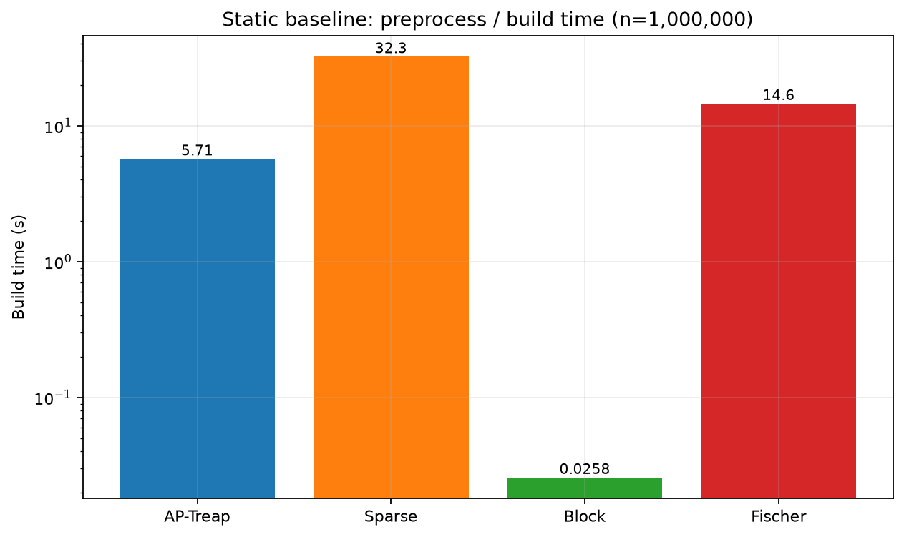
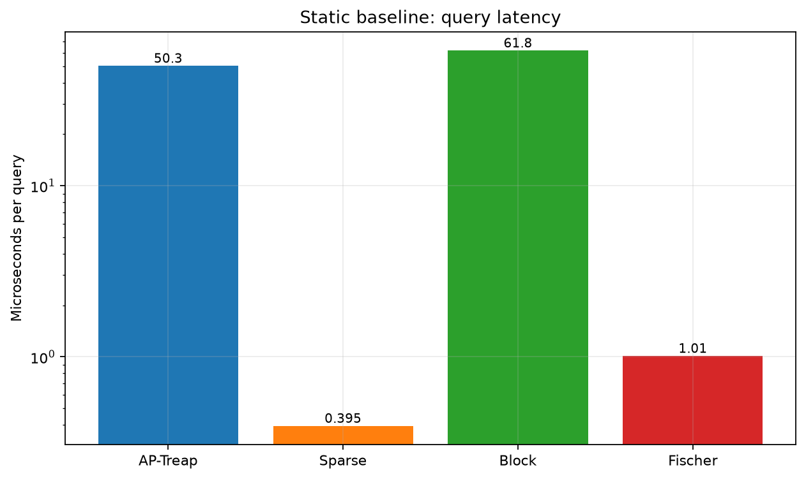
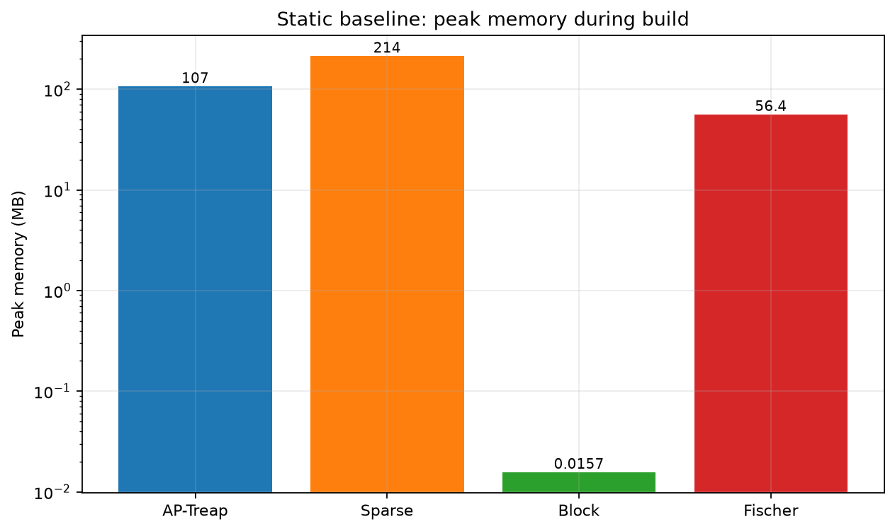
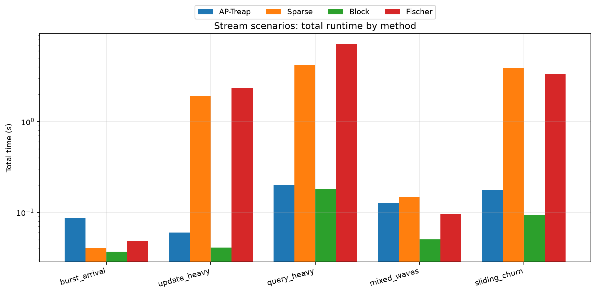
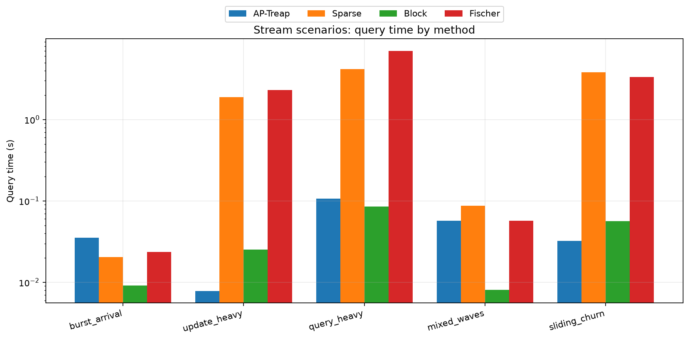
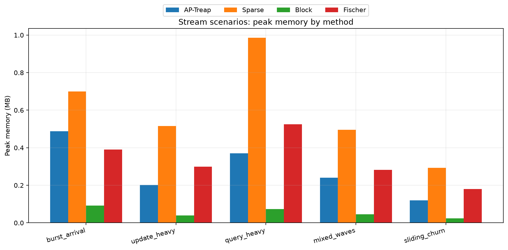
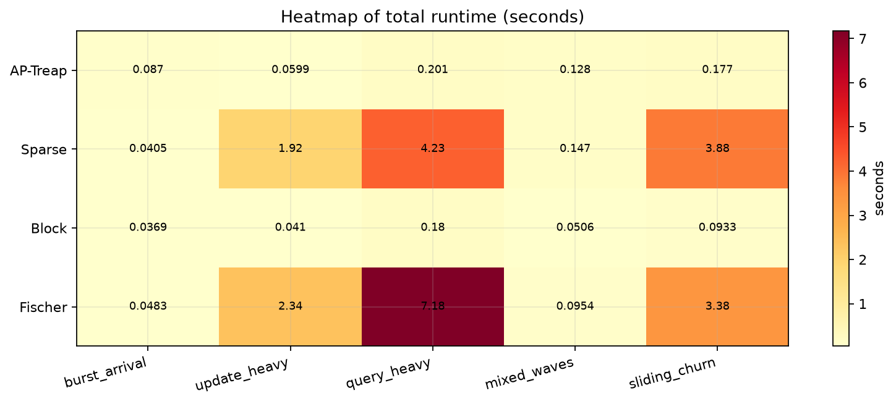
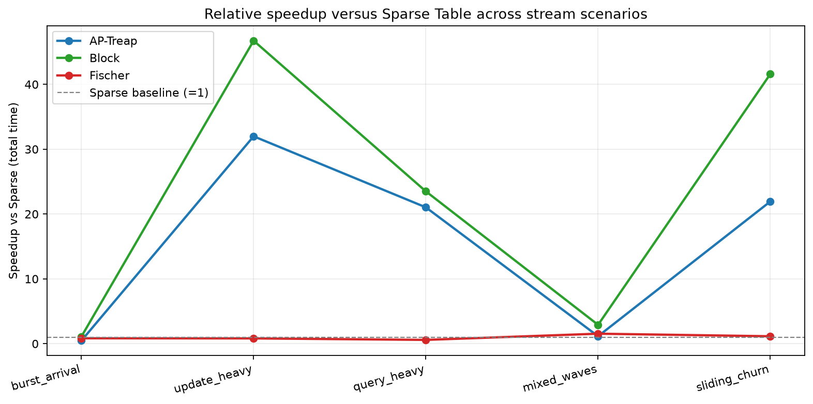

# Performance Comparison Report — RMQ Methods

<div dir="rtl">

## ۱. هدف این گزارش

این سند **متمرکز بر مقایسه عملکرد** چهار روش است:

- روش پیشنهادی: AP-Treap
- روش‌های تدریس‌شده: Sparse Table، Block Decomposition، Fischer-Heun

مقایسه در دو رژیم انجام شده است:

- خط‌پایه‌ی **ایستا** روی یک میلیون عنصر از `rmq_data.csv`
- پنج سناریوی **جریان داده پویا** روی پیشوند ۲۰٬۰۰۰ عنصری

نمودارها از خروجی آزمایش (`experiment_terminal_output.txt`) با اسکریپت `generate_charts.py` تولید شده‌اند. برای بازتولید:

</div>

```bash
python main.py
python generate_charts.py
```

<div dir="rtl">

---

## ۲. خلاصه اجرایی مقایسه

| سؤال مقایسه‌ای | جمع‌بندی کوتاه |
|---|---|
| در ایستا سریع‌ترین کوئری کدام است؟ | Sparse Table، سپس Fischer-Heun |
| در ایستا سبک‌ترین ساختار کدام است؟ | Block Decomposition |
| در جریان با جهش زیاد، Sparse/Fischer چگونه‌اند؟ | معمولاً کندتر از AP-Treap به‌خاطر هزینه‌ی rebuild |
| در مقیاس متوسط سناریوها، رقیب عملی کیست؟ | Block با rebuild ارزان اغلب زمان کل خوبی دارد |
| دقت همه روش‌ها؟ | در همه‌ی آزمایش‌ها برابر ۱.۰۰۰ |

---

## ۳. مقایسه در خط‌پایه‌ی ایستا

### ۳.۱ زمان ساخت

شکل زیر زمان پیش‌پردازش/ساخت را روی \(n=10^6\) نشان می‌دهد (محور لگاریتمی).

</div>



<div dir="rtl">

**خوانش نمودار:**

- سریع‌ترین ساخت متعلق به Block است.
- Sparse سنگین‌ترین ساخت را دارد.
- AP-Treap بین Fischer و Sparse قرار می‌گیرد و هزینه‌ی ساخت قابل‌قبولی برای ساختار پویا می‌پردازد.

### ۳.۲ تأخیر کوئری

</div>



<div dir="rtl">

**خوانش نمودار:**

- Sparse با اختلاف زیاد کم‌ترین تأخیر کوئری را دارد.
- Fischer نزدیک به Sparse و هنوز بسیار سریع است.
- AP-Treap و Block در ایستا کندترند؛ این با پیچیدگی O(log n) و O(√n) سازگار است.

### ۳.۳ حافظه‌ی اوج هنگام ساخت

</div>



<div dir="rtl">

**خوانش نمودار:**

- Sparse بیشترین حافظه را مصرف می‌کند (سازگار با فضای O(n log n)).
- Block کم‌حجم‌ترین است.
- AP-Treap حافظه‌ی خطی دارد و بین Block و Sparse قرار می‌گیرد.

**نتیجه‌ی ایستا:** اگر مسئله واقعاً ایستا و کوئری‌محور باشد، Sparse یا Fischer برنده‌اند. ارزش AP-Treap در ایستا، صحت یکسان و آمادگی برای پویایی است، نه برتری asymptotic کوئری.

---

## ۴. مقایسه در سناریوهای جریان داده

سناریوها:

| سناریو | ماهیت بار |
|---|---|
| `burst_arrival` | ورود انبوه سپس کوئری زیاد |
| `update_heavy` | درج/حذف زیاد |
| `query_heavy` | کوئری غالب با جهش گاه‌به‌گاه |
| `mixed_waves` | موج‌های متناوب |
| `sliding_churn` | پنجره‌ی لغزان |

### ۴.۱ زمان کل اجرا (لگاریتمی)

</div>



<div dir="rtl">

**خوانش نمودار:**

- در `update_heavy`، `query_heavy` و `sliding_churn` میله‌های Sparse و Fischer به‌وضوح بلندترند.
- AP-Treap در این سناریوها نسبت به Sparse/Fischer پایدارتر و معمولاً بسیار سریع‌تر است.
- Block به‌خاطر بازسازی ارزان در مقیاس متوسط اغلب زمان کل رقابتی یا بهتر دارد.

### ۴.۲ زمان صرف‌شده در کوئری‌ها

</div>



<div dir="rtl">

**خوانش نمودار:**

- بخش عمده‌ی کندی Sparse/Fischer در جریان، روی زمان کوئری دیده می‌شود؛ چون سیاست lazy، هزینه‌ی rebuild را هنگام کوئری پرداخت می‌کند.
- AP-Treap هزینه‌ی کوئری را بدون rebuild سراسری نگه می‌دارد.

### ۴.۳ حافظه‌ی اوج در جریان

</div>



<div dir="rtl">

**خوانش نمودار:**

- Sparse معمولاً بیشترین حافظه‌ی اوج را دارد.
- Block کم‌حجم‌ترین است.
- AP-Treap و Fischer در میانه‌اند.

### ۴.۴ نقشه حرارتی زمان کل

</div>



<div dir="rtl">

**خوانش نمودار:**

- خانه‌های تیره‌تر یعنی زمان بیشتر.
- ردیف Sparse و Fischer در چند سناریوی جهش‌محور تیره‌تر از AP-Treap است.
- ردیف Block اغلب روشن‌تر می‌ماند.

### ۴.۵ شتاب نسبی نسبت به Sparse

محور عمودی برابر است با:

\[
\text{Speedup} = \frac{T_{\text{Sparse}}}{T_{\text{method}}}
\]

مقدار بزرگ‌تر از ۱ یعنی آن روش از Sparse سریع‌تر بوده است.

</div>



<div dir="rtl">

**خوانش نمودار:**

- خط چین مقدار ۱ (برابری با Sparse) است.
- AP-Treap و Block در سناریوهای جهش‌محور معمولاً بالای خط ۱ قرار می‌گیرند.
- Fischer نزدیک Sparse یا حتی بدتر می‌ماند، چون هر دو هزینه‌ی rebuild سنگین دارند.

---

## ۵. جدول تصمیم مبتنی بر نمودارها

| الگوی بار | برنده‌ی عملی در این اجرا | توضیح مقایسه‌ای |
|---|---|---|
| ایستای کوئری‌محور | Sparse / Fischer | کم‌ترین تأخیر کوئری در نمودارهای ایستا |
| ایستای حافظه‌محور | Block | کم‌ترین حافظه در نمودار ایستا و جریان |
| جریان با جهش زیاد | AP-Treap (در برابر Sparse/Fischer) | شتاب بالا در نمودار speedup |
| جریان با n متوسط و نیاز به سرعت کل | Block اغلب قوی | rebuild ارزان در heatmap روشن‌تر است |
| نیاز همزمان به پویایی واقعی + مقیاس‌پذیری | AP-Treap | به‌روزرسانی O(log n) بدون rebuild سراسری |

---

## ۶. جمع‌بندی مقایسه‌ای

- در **ایستا**، Sparse سریع‌ترین کوئری و Block کم‌حجم‌ترین ساختار است؛ Fischer مصالحه‌ی کلاسیک خوبی می‌دهد.
- در **جریان پویا**، نمودارها نشان می‌دهند هزینه‌ی rebuild Sparse/Fischer در سناریوهای جهش‌محور غالب می‌شود.
- **AP-Treap** در برابر Sparse و Fischer در `update_heavy`، `query_heavy` و `sliding_churn` برتری عملی روشنی دارد.
- **Block** رقیب جدی wall-clock در مقیاس متوسط است و باید در هر بحث «کجا چه چیزی مناسب است» جداگانه لحاظ شود.
- دقت همه‌ی روش‌ها در آزمایش‌ها کامل بود؛ تفاوت‌ها عمدتاً زمانی و حافظه‌ای‌اند نه صحت پاسخ.

---

## ۷. فهرست نمودارها و بازتولید

| فایل | محتوا |
|---|---|
| `charts/static_build_time.png` | زمان ساخت ایستا |
| `charts/static_query_latency.png` | تأخیر کوئری ایستا |
| `charts/static_peak_memory.png` | حافظه‌ی اوج ایستا |
| `charts/stream_total_time.png` | زمان کل سناریوها |
| `charts/stream_query_time.png` | زمان کوئری سناریوها |
| `charts/stream_peak_memory.png` | حافظه‌ی اوج سناریوها |
| `charts/stream_total_time_heatmap.png` | نقشه حرارتی زمان کل |
| `charts/stream_speedup_vs_sparse.png` | شتاب نسبت به Sparse |

بازتولید پس از هر اجرای جدید آزمایش:

</div>

```bash
python main.py
python generate_charts.py
```
